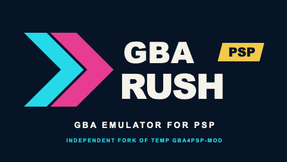
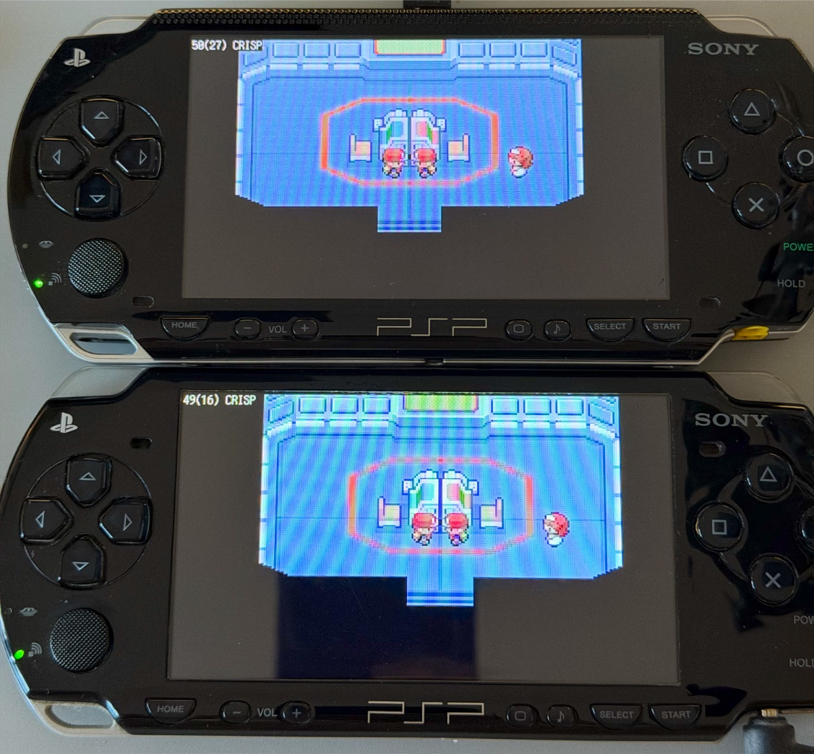

<p align="center">
  
</p>

# GBA Rush PSP

A Game Boy Advance emulator for PlayStation Portable, focused on real-hardware
performance and a clear handheld interface.

GBA Rush PSP is an independent fork of
[andymcca/TempGBA4PSP-mod](https://github.com/andymcca/TempGBA4PSP-mod). It
retains the emulator core, renderers, interface, compatibility work and
launcher developed across gpSP, gpSP Kai, TempGBA and TempGBA4PSP-mod. The
fork is maintained separately and does not imply upstream endorsement.

You must provide your own legally obtained ROM dumps; none are included in
this repository or its releases. A dump of the GBA BIOS is optional: without
one, GBA Rush PSP uses the open-source BIOS built into the EBOOT.

## Features

- Old and new gpSP renderers, plus an experimental Exact renderer that
  matches mGBA pixel for pixel and, on custom firmware, draws on the Media
  Engine, with sharp, aspect-correct and adaptive 16:9 presentation modes.
- Two CPU cores: the Classic gpSP dynarec, and an experimental New core
  written from scratch that runs like mGBA instruction by instruction.
- Modern, Classic and Custom fast-forward profiles, global defaults and
  optional per-game overrides.
- Full-scale 16-bit audio mixing and optional 2x/3x accelerated audio.
- Plaintext and encrypted CodeBreaker support, including timed master hooks.
- Existing GameShark, Pro Action Replay and direct-write cheat formats.
- Two-PSP GBA link cable over local ad-hoc Wi-Fi, with a full-speed mode for
  Pokemon trades and battles across Ruby, Sapphire, Emerald, FireRed and
  LeafGreen.
- Starts without a BIOS dump, using a built-in open-source GBA BIOS when
  `gba_bios.bin` is missing.
- Suspend and resume recovery for audio, ROM access, saves and video state.
- Box art, recent ROMs, themes, configurable controls and per-game settings.
- Japanese, English, Simplified Chinese, Traditional Chinese and Italian UI.
- On-device performance reports and host regression, sanitizer and package
  checks.

## Install and upgrade

Extract the release ZIP at the root of the Memory Stick (`ms0:`, or the
internal storage `ef0:` of a PSP Go): it creates `PSP/GAME/GBARushPSP/` with
the emulator and, in `docs/`, this documentation. Put your games in `roms/`
or beside the EBOOT, and if you have a dump of your own GBA BIOS, add it as
`gba_bios.bin`:

```text
PSP/GAME/GBARushPSP/
├── EBOOT.PBP
├── exception.prx
├── media_engine.prx
├── docs/
├── roms/             (optional)
└── gba_bios.bin      (optional)
```

Without `gba_bios.bin` the emulator uses its built-in open-source BIOS; a
`gba_bios.bin` that is not a 16 KB GBA BIOS is reported at startup and the
built-in one is used instead. Some games behave differently with the built-in
BIOS ([source/bios](source/bios/README.md) lists the known differences), so a
dump of your own BIOS stays the more compatible choice and is always used when
present. The BIOS is read when the emulator starts, so restart it after adding
or moving `gba_bios.bin`.

A savestate loads only with the BIOS it was saved with: keep `gba_bios.bin` if
you have savestates made with it. Each BIOS keeps its own automatic savestate
(`<rom>_auto.svs` with `gba_bios.bin`, `<rom>_auto-builtin.svs` with the
built-in BIOS), so switching never overwrites the other one.

Start GBA Rush PSP from the PSP Game menu and select a ROM. The ROM browser
opens in `roms/` when that folder exists, otherwise in the EBOOT folder;
saves, savestates and the other files stay in the EBOOT folder. An optional
`dir.ini` beside the EBOOT can point ROMs, saves, states, screenshots, cheats
and box art to separate directories.

To upgrade, extract the new release ZIP at the root in the same way and let it
replace the existing files. The ZIP holds only the programs and the
documentation, so the BIOS, ROMs, saves, savestates, cheat lists and
configuration files stay as they are. Back up important save data before an
update.

## Controls

HOME opens the emulator menu. Holding **START+SELECT** for half a second opens
it too, for systems where HOME does not reach the emulator. The hold never
quits the game, and it does not count while a button mapped to GBA A or B is
held, so A+B+START+SELECT still resets games that use it. The game receives
START and SELECT during the hold and may open its own pause screen.

HOME opens the menu as soon as it is pressed, even with A or B held. If HOME
shows the system's quit screen instead of the emulator menu, leave that screen
without quitting and use the hold.

**SELECT+L** saves to the current savestate slot and **SELECT+R** loads it,
with the usual confirmation. Hold SELECT, then press L or R: the game does not
receive that L or R while it stays held. Pressing L or R first and SELECT
after does nothing.

Shortcuts act on the press that completes them, with no added delay, so a
longer sequence stops there: SELECT, then L, then R saves as soon as L is
pressed. They are kept with the settings and in each game's settings. The
single-button mappings in the controls menu work as before.

## Fast-forward

Assign **Fast forward** in the controls menu. Triangle is the default.

- **Modern** runs at maximum speed while the button is held, presents at a
  steady 30 fps target and mutes audio.
- **Classic** cycles through Normal, 2x and 3x on each press. It uses fixed
  frame presentation and muted audio.
- **Custom** selects Hold or Toggle, 2x, 3x or Maximum, three presentation
  rates and Silent or Accelerated audio.

Accelerated audio is available at 2x and 3x. If the PSP cannot keep its audio
buffer fed, the current fast-forward session falls back to silence. Opening a
menu, resetting, changing ROM, suspending, exiting or starting a link session
always returns to normal speed.

## Video

`16:9 Auto` fills the PSP display. It starts with the two-pass Sharp path,
falls back to the lighter Crisp path after sustained timing misses and returns
to Sharp after a stable interval. The FPS overlay shows the active level.

Integer and aspect-correct modes remain available when preserving GBA geometry
is more important than filling the display.

## CPU core

**Performance > Advanced settings > CPU core** picks the processor emulation:

- **Classic**, the default, is the gpSP dynarec GBA Rush has always used.
- **New** is a core written from scratch for GBA Rush. In the games it is
  checked with it runs every instruction, cycle counts included, as mGBA
  does, and it compiles the game's code to the PSP's own instructions. It
  is being tested.

The choice takes effect when a game starts or is reset. With Show FPS on,
the counter ends in NEW while the New core runs. Savestates load in either
core. Saves, cheats (CodeBreaker hooks included), fast-forward and the link
cable go through the same emulator code with both cores.

The New core does not use the idle loop shortcuts of `game_config.txt`. A
ROM smaller than 16 MB repeats past its end, where the Classic core reads
open bus.

## Cheats

Open **Cheats options**, choose **Load cheat file** and select a `.cht` file.
A successful load shows the filename, entry count, names and `ON`/`OFF` state.
Lists are selected manually because codes depend on the exact game region and
revision.

Each entry starts with its format and display name, followed by code lines and
a blank line:

```text
codebreaker Example entry
82000100 1234

direct_v1 Example direct write
22000104 00000001
```

Supported headers are `codebreaker`, `codebreaker_v1`, `codebreaker_v2`, `CB`,
`gameshark_v1`, `gameshark_v2`, `gameshark_v3`, `PAR_v1`, `PAR_v2`, `PAR_v3`,
`direct_v1`, `direct_v2` and `direct_v3`.

For CodeBreaker lists with a timed master, enable the master entry before the
ordinary entries. If enabled masters use different hook addresses, the most
recent master takes ownership and incompatible masters are disabled. Keep a
backup of important saves when testing cheats.

## Link cable

Two PSPs can connect as if a GBA link cable joined them. Both need this
version of GBA Rush PSP; the games may differ.



1. Load the game on both PSPs with WLAN on.
2. On the first PSP open **Main menu > Link cable > Create session**.
3. On the second PSP choose **Join session**.

The cable chooses its technique from the two games. Ruby, Sapphire, Emerald,
FireRed and LeafGreen, in any combination, run at full speed: each PSP
emulates the wire locally and only the games' link frames cross the network.
In FireRed and LeafGreen use the Cable Club on the Pokemon Center's second
floor. Every other game exchanges each serial word with the other PSP. Once
the other PSP has proved it can announce its next word in advance, as Mario
Kart: Super Circuit allows, the PSP that clocks the transfers stops waiting
for each reply; games that send many words per frame still slow down.

Fast-forward and savestates are disabled while connected. In games that
exchange each serial word the emulator draws at least every other frame,
whatever the frameskip setting, which applies again once the link closes.
Reset, ROM change, suspend and exit close the session. Normal 8-bit, Normal 32-bit and
two-player Multiplayer modes are supported; the Wireless Adapter, four
players, UART, JoyBus, multiboot and internet play are not. Back up both
saves before trading.

The [link cable notes](docs/link-cable.md) explain the design, tests and log
decoding. The [1.4.0 checklist](docs/ROADMAP-1.4.0.md) lists the remaining
hardware tests.

## Build and test

See [CONTRIBUTING.md](CONTRIBUTING.md) for the source layout, verification
commands and hardware-test procedure.

A current [PSPDev](https://pspdev.github.io/) toolchain must provide
`psp-config` in `PATH`.

```sh
make check
make test-sanitize
make psp-build
```

`make check` covers the portable cheat, serial, link, lifecycle, menu, video,
configuration, fast-forward, dynarec and audio modules. Generated PSP files are
written under `source/` and ignored by Git.

The official PSPDev container can replace a local toolchain:

```sh
docker run --rm -v "$PWD:/workspace" -w /workspace/source pspdev/pspdev:latest make
```

After a successful candidate build:

```sh
make package VERSION=1.4.3
```

The package command creates a reproducible ZIP and SHA-256 checksum under
`dist/`, laid out to extract at the root of the Memory Stick, then verifies
the archive manifest. The archive includes the license notices (with the
built-in BIOS notes in `source/bios/README.md`), installation guide and
current link test checklist. It never includes `gba_bios.bin`, ROMs, saves,
savestates, settings, `dir.ini` or cheat databases: the check refuses an
archive with a BIOS, ROM, save, savestate, settings file or `dir.ini`. The
command needs a Git tag named after the version and no uncommitted changes
in `source/`: the corresponding source ZIP,
`dist/GBA-Rush-PSP-<version>-source.zip`, is made from that tag.

### Performance comparison

On PSP, use **Diagnostics > Start measurement**, play a repeatable section,
stop measurement and save the report. Collect three reports per build, then
run:

```sh
python3 scripts/compare-benchmarks.py \
  --baseline old-1.txt old-2.txt old-3.txt \
  --candidate new-1.txt new-2.txt new-3.txt
```

The comparison checks throughput, frame-time and GE-wait tails, audio
underruns, skipped frames and, when recorded, the measured fast-forward
multiplier.

## Single-game launcher

The optional launcher creates a separate XMB bubble for one ROM. Build its PSP
stub first, then run the desktop tool:

```sh
make launcher-stub
python3 -m pip install -r source/single-game_launcher/tool/requirements.txt
python3 source/single-game_launcher/tool/gui.py
```

See the [launcher README](https://github.com/redcode9/GBA-Rush-PSP/blob/master/source/single-game_launcher/tool/README.md) for asset
sizes and required external tools.

## Credits and license

GBA Rush PSP exists because of work by Exophase and gpSP contributors; notaz;
Takka and the gpSP Kai contributors; Nebuleon, Normmatt, BassAceGold and the
TempGBA community; Phoe-nix; andymcca; JxPv2; and every contributor to the
[direct upstream repository](https://github.com/andymcca/TempGBA4PSP-mod).
Relevant fixes from [libretro/gpSP](https://github.com/libretro/gpsp) are
retained with source history and notices. The built-in BIOS is Normmatt's
open-source GBA BIOS, based on the VBA and VBA-M HLE BIOS, as shipped by
libretro/gpSP and Nebuleon's ReGBA; its source and notices are in
[source/bios](source/bios/README.md).

The emulator is GPL-2.0-or-later; see [LICENSE](LICENSE), [NOTICE](NOTICE),
`source/copyright` and source headers. The launcher builder is
GPL-3.0-or-later and carries separate notices in its directory.

GBA Rush PSP is not affiliated with or endorsed by Nintendo, Sony,
CodeBreaker or the upstream maintainers.
