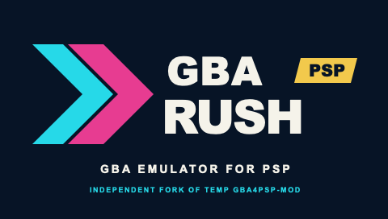

<p align="center">
  
</p>

# GBA Rush PSP

A Game Boy Advance emulator for PlayStation Portable, focused on real-hardware
performance and a clear handheld interface.

GBA Rush PSP is an independent fork of
[andymcca/TempGBA4PSP-mod](https://github.com/andymcca/TempGBA4PSP-mod). It
retains the emulator core, renderers, interface, compatibility work and
launcher developed across gpSP, gpSP Kai, TempGBA and TempGBA4PSP-mod. The
fork is maintained separately and does not imply upstream endorsement.

You must provide your own legally obtained GBA BIOS and ROM dumps. Neither is
included in this repository or its releases.

## Features

- Old and new gpSP renderers with sharp, aspect-correct and adaptive 16:9
  presentation modes.
- Modern, Classic and Custom fast-forward profiles, global defaults and
  optional per-game overrides.
- Full-scale 16-bit audio mixing and optional 2x/3x accelerated audio.
- Plaintext and encrypted CodeBreaker support, including timed master hooks.
- Existing GameShark, Pro Action Replay and direct-write cheat formats.
- Experimental two-PSP GBA cable emulation over local ad-hoc Wi-Fi.
- Suspend and resume recovery for audio, ROM access, saves and video state.
- Box art, recent ROMs, themes, configurable controls and per-game settings.
- Japanese, English, Simplified Chinese, Traditional Chinese and Italian UI.
- On-device performance reports and host regression, sanitizer and package
  checks.

## Install and upgrade

Copy the release folder to `PSP/GAME/GBARushPSP/`, then add your own
`gba_bios.bin`:

```text
PSP/GAME/GBARushPSP/
├── EBOOT.PBP
├── exception.prx
└── gba_bios.bin
```

Start GBA Rush PSP from the PSP Game menu and select a ROM. A `dir.ini` beside
the EBOOT can point ROMs, saves, states, screenshots, cheats and box art to
separate directories.

To upgrade, replace only `EBOOT.PBP` and `exception.prx`. Keep the BIOS, ROMs,
saves, savestates, cheat lists and configuration files. Back up important save
data before an update.

## Fast-forward

Assign **Fast forward** in the controls menu. Triangle is the default.

- **Modern** runs at maximum speed while the button is held, presents at a
  steady 30 fps target and mutes audio.
- **Classic** cycles through Normal, 2x and 3x on each press. It uses fixed
  frame presentation and muted audio.
- **Custom** selects Hold or Toggle, 2x, 3x or Maximum, three presentation
  rates and Silent or Accelerated audio.

Accelerated audio is available at 2x and 3x. If the PSP cannot keep its audio
buffer fed, the current fast-forward session falls back to silence. Opening a
menu, resetting, changing ROM, suspending, exiting or starting a link session
always returns to normal speed.

## Video

`16:9 Auto` fills the PSP display. It starts with the two-pass Sharp path,
falls back to the lighter Crisp path after sustained timing misses and returns
to Sharp after a stable interval. The FPS overlay shows the active level.

Integer and aspect-correct modes remain available when preserving GBA geometry
is more important than filling the display.

## Cheats

Open **Cheats options**, choose **Load cheat file** and select a `.cht` file.
A successful load shows the filename, entry count, names and `ON`/`OFF` state.
Lists are selected manually because codes depend on the exact game region and
revision.

Each entry starts with its format and display name, followed by code lines and
a blank line:

```text
codebreaker Example entry
82000100 1234

direct_v1 Example direct write
22000104 00000001
```

Supported headers are `codebreaker`, `codebreaker_v1`, `codebreaker_v2`, `CB`,
`gameshark_v1`, `gameshark_v2`, `gameshark_v3`, `PAR_v1`, `PAR_v2`, `PAR_v3`,
`direct_v1`, `direct_v2` and `direct_v3`.

For CodeBreaker lists with a timed master, enable the master entry before the
ordinary entries. If enabled masters use different hook addresses, the most
recent master takes ownership and incompatible masters are disabled. Keep a
backup of important saves when testing cheats.

## Link cable

Two-player cable emulation is experimental. The 1.4.0 candidate includes
protocol v3 and a built-in no-ROM benchmark.
The last recorded FireRed trial failed before a serial transfer; a completed
trade and the paired hardware benchmark remain unverified.

Use the same build on both PSPs with WLAN enabled. Open **Main menu > Link cable**:
Player 1 creates a session and Player 2 joins. For gameplay, load a game on both
systems before connecting. Fast-forward and savestates are disabled while the
session is open; reset, ROM change, suspend and exit disconnect it.

Normal 8-bit, Normal 32-bit and two-player Multiplayer 16-bit paths exist.
Wireless Adapter, additional players, UART, JoyBus, multiboot and internet relay
are outside the current scope.

The [implementation notes](docs/link-cable.md) describe the development protocol,
benchmark and log tools. The [1.4.0 checklist](docs/ROADMAP-1.4.0.md) gives the
remaining fixes and hardware tests. Keep backups of both saves during testing.

## Build and test

See [CONTRIBUTING.md](CONTRIBUTING.md) for the source layout, verification
commands and hardware-test procedure.

A current [PSPDev](https://pspdev.github.io/) toolchain must provide
`psp-config` in `PATH`.

```sh
make check
make test-sanitize
make psp-build
```

`make check` covers the portable cheat, serial, link, lifecycle, menu, video,
configuration, fast-forward, dynarec and audio modules. Generated PSP files are
written under `source/` and ignored by Git.

The official PSPDev container can replace a local toolchain:

```sh
docker run --rm -v "$PWD:/workspace" -w /workspace/source pspdev/pspdev:latest make
```

After a successful candidate build:

```sh
make package VERSION=1.4.0-rc.4
```

The package command creates a reproducible ZIP and SHA-256 checksum under
`dist/`, then verifies the archive manifest. The archive includes the license
notices, installation guide and current link test checklist. It never includes
BIOS files, ROMs, saves, settings or cheat databases.

### Performance comparison

On PSP, use **Diagnostics > Start measurement**, play a repeatable section,
stop measurement and save the report. Collect three reports per build, then
run:

```sh
python3 scripts/compare-benchmarks.py \
  --baseline old-1.txt old-2.txt old-3.txt \
  --candidate new-1.txt new-2.txt new-3.txt
```

The comparison checks throughput, frame-time and GE-wait tails, audio
underruns, skipped frames and, when recorded, the measured fast-forward
multiplier.

## Single-game launcher

The optional launcher creates a separate XMB bubble for one ROM. Build its PSP
stub first, then run the desktop tool:

```sh
make launcher-stub
python3 -m pip install -r source/single-game_launcher/tool/requirements.txt
python3 source/single-game_launcher/tool/gui.py
```

See the [launcher README](https://github.com/redcode9/GBA-Rush-PSP/blob/master/source/single-game_launcher/tool/README.md) for asset
sizes and required external tools.

## Credits and license

GBA Rush PSP exists because of work by Exophase and gpSP contributors; notaz;
Takka and the gpSP Kai contributors; Nebuleon, Normmatt, BassAceGold and the
TempGBA community; Phoe-nix; andymcca; JxPv2; and every contributor to the
[direct upstream repository](https://github.com/andymcca/TempGBA4PSP-mod).
Relevant fixes from [libretro/gpSP](https://github.com/libretro/gpsp) are
retained with source history and notices.

The emulator is GPL-2.0-or-later; see [LICENSE](LICENSE), [NOTICE](NOTICE),
`source/copyright` and source headers. The launcher builder is
GPL-3.0-or-later and carries separate notices in its directory.

GBA Rush PSP is not affiliated with or endorsed by Nintendo, Sony,
CodeBreaker or the upstream maintainers.
