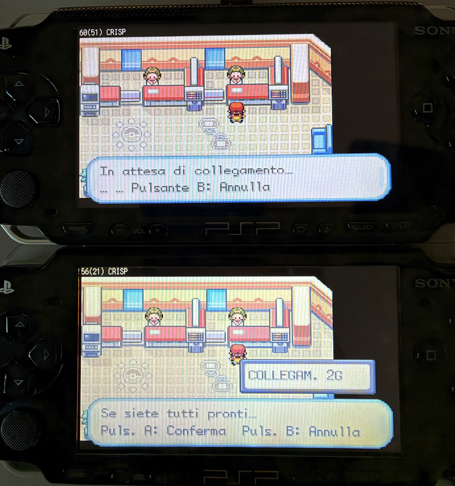
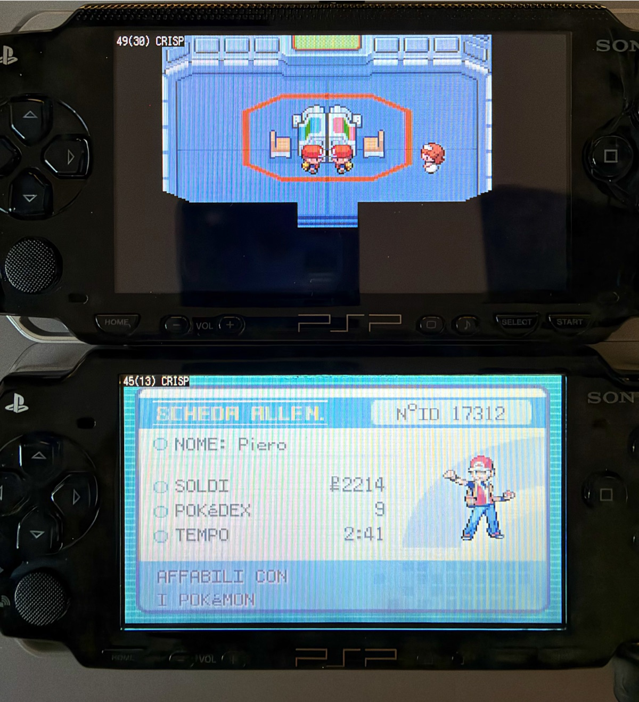

# Link cable

GBA Rush PSP emulates the two-player GBA link cable over PSP ad-hoc Wi-Fi.
Both consoles need the same GBA Rush PSP version; the games may differ.

## Why the cable cannot simply be forwarded

A real cable exchanges a 16-bit word every few hundred microseconds and both
GBAs see the result at the same instant. A round trip over PSP ad-hoc Wi-Fi
takes several milliseconds. FireRed sends nine words per frame, so waiting for
the other PSP on every word costs about nine round trips per frame and drops
the game far below full speed. The cable therefore picks a technique per pair
of games when the two consoles connect.

## Pokemon mode

Used automatically when both consoles run Ruby, Sapphire, Emerald, FireRed or
LeafGreen, in any combination (FireRed with LeafGreen, Emerald with FireRed and
so on). Detection uses the ROM header game code, so translations, revisions
and ROM hacks of these games are covered too.

These games wrap the cable in their own link layer (`src/link.c` in the pret
decompilations). Every frame the master sends one checksum word and eight data
words, an all-zero frame means "nothing to say", and the game copes with
frames that arrive a few frames late. GBA Rush PSP uses that:

- Each console emulates the wire locally at full speed. Transfers complete
  without waiting for the network, and the joiner's console plays the role of
  the master clock (one transfer per frame during the handshake, then about ten
  per frame, slightly faster than the host's nine, and one nine-word frame
  per video frame in the Cable Club rooms).
- Only non-empty frames cross the network.
- The host decides how its frames pair with the joiner's and sends the joiner
  the exact pair. Both games therefore process identical frames in the same
  order, which keeps the Cable Club room (where every frame carries both
  players' keys) identical on both screens.
- Each game's checksum word is echoed back to it, so the checksum always
  matches what the game computed over the words it received.
- The handshake words (0xB9A0 and 0x8FFF) are mirrored exactly as the game's
  `DoHandshake` counts them, so the link opens and closes on the same transfer
  the game expects.

In the Cable Club rooms both games send their held keys on every frame, and
a game that receives nothing skips its frame but keeps sending. Left alone,
every stall of one console or of the radio would leave frames queued between
the two games for good, and the room would lag further behind each time.
There the consoles therefore behave like a real cable: each one waits for
the other's next frame before it starts its own, and the joiner answers every
host frame even when it has nothing to say. The host only goes ahead without
an answer while the frames in flight do not cover a round trip plus five
frames of margin, which sets a fixed delay of roughly 130 to 150 ms at the
round trips measured between two PSPs. A console stops waiting when the
other game closes its link, and after one second in any case.

The idea of emulating the wire locally for these games follows the Pokemon
backend of [gpSP libretro](https://github.com/libretro/gpsp/blob/master/serial_proto.c).
The host-authoritative pairing is added here because without it the two
consoles can pair frames differently and the link room diverges.

## Lockstep mode

Used for every other game, and for any mix of a Pokemon game with another
game. Each serial transfer goes to the other console, which latches it into
its own serial registers and answers with its outgoing word. The console that
clocks the transfer keeps running for as long as the transfer would take on
real hardware and only stops if the answer is still missing at that moment.
The receiving console sees every transfer at the point of its own timeline
the sender chose, as on a real cable: it keeps the spacing the sender's game
used between transfers and never runs past the clock the sender last
reported, which the sender sends every 2 ms while the link is in use. A
receiver left free would run ahead while the sender waits for replies and
go whole frames without a transfer; Mario Kart: Super Circuit reports a
communication error when that happens.

Waiting a round trip for every reply still halves the speed of a game that
sends a word per frame. Most games, Mario Kart included, load the word for
the next transfer right after the last one, long before the next START. The
receiving console therefore announces its next reply once its game has
written the serial registers after a transfer and left them alone for a
moment. The sender compares each announcement with the real reply that
follows it. Once 300 announcements in a row have been right, it completes
its transfers with the announcement instead of waiting, and keeps checking
each one. An announcement that was used and turned out wrong sends it back
to waiting and doubles the number of right ones it needs next time, so a
game that changes its word late keeps the exact behaviour. A transfer whose
announcement has not arrived yet waits for the reply as before.

Normal 8-bit, Normal 32-bit and Multiplayer 16-bit modes are supported. A
game that sends many words per frame still waits for most replies and slows
both consoles down.

## Transport and pacing

`psp_adhoc.c` brings up the network on a worker thread that runs above the
emulator thread, creates or joins the `GBARUSH` group and only moves datagrams
through two lock-free queues. All link logic runs on the emulator thread.
A datagram the PSP network stack refuses is dropped, since the next one
repeats its messages; retrying at once made the stack hold datagrams for
seconds. Part of that stack runs below the emulator thread, so while a link
is open every frame that runs late still sleeps for 2 ms; a console that
never slept held datagrams for seconds too, until the link was lost. For the
same reason a datagram queued while the guest runs only leaves when the
emulator next sleeps. In lockstep mode the emulator therefore pauses for
0.2 ms after each datagram it queues while running, and its thread drops to
a lower priority; without that the two consoles took turns, each emulating
its frame while the other waited for its clock. The pause is what matters:
the lower priority alone still left the stack refusing datagrams. Each datagram
costs the PSP close to a millisecond of processor time in the stack, so
every datagram saved counts.

`link_net.c` makes the datagrams reliable and ordered. Every datagram repeats
all messages the other side has not acknowledged yet, as GGPO does with
inputs, so a lost packet is repaired by the next one instead of a timer. Each
header also carries the guest clock, the number of consumed messages and a
timestamp echo used to measure the round trip.

In lockstep mode a console may run at most four frames ahead of the other
one's guest clock while the link is in use. Only the console that is ahead
waits, so the rule cannot deadlock, and it absorbs speed differences such as
a PSP-1000 that falls below full speed. Pokemon mode does not pace on the
guest clocks, which reach the other PSP tens of milliseconds late and made
both consoles wait for each other after every radio dropout; its games wait
for each other's frames in the rooms instead. A peer that stays silent for
eight seconds ends the session. While a console waits, input, the HOME menu
and power events keep working.

## Using it

1. Load the game on both PSPs, with WLAN on.
2. On the first PSP open **Main menu > Link cable > Create session**.
3. On the second PSP choose **Join session**.
4. The status line shows the player number. The line below it shows which
   technique was chosen and the measured round trip.





In FireRed and LeafGreen talk to the Cable Club attendants on the Pokemon
Center's second floor; the Wireless Club needs the Wireless Adapter, which is
not emulated. Fast-forward
and savestates are disabled while connected. Reset, ROM change, suspend and
exit close the session and tell the other PSP.

## Tests

`make check` runs the host tests, including:

- `tests/test_link_net.c`: exactly-once, in-order delivery with up to 50% loss,
  duplicates and reordering; stale peers and malformed packets are rejected.
- `tests/test_link_cable.c`: two simulated consoles with independent clocks
  linked over simulated Wi-Fi with delay, jitter, loss, duplicates, reordering
  and a 400 ms outage. The Pokemon guest is a line-by-line port of the pret
  FireRed serial driver, including the link room's key stream that keeps
  sending while the game skips frames. Each run opens the link, exchanges
  link-player blocks, plays 240 frames of link-room keys, trades a 600-byte
  party block and closes the link, in nine game, speed and console-freeze
  combinations over five network profiles. It passes only with no link
  error, intact blocks, identical key frames on both consoles and each
  player's own keys coming back within 20 frames on average in the room.
  Lockstep guests check Multiplayer, Normal 8-bit and Normal 32-bit modes
  word by word; the Multiplayer slave reports a link error after two frames
  in a row without a transfer, and its replies depend on the words it
  received, so a wrong announcement shows up as a mismatch.
- `proofs/cbmc/prove_link_net.c` (`make check-cbmc`): CBMC proves that any
  datagram up to the proof bound is parsed without out-of-bounds access or
  overflow.
- `make check-rom-link` (optional): two mGBA cores run your own FireRed ROM
  with this cable's code in between. A script walks both players into the
  Cable Club, trades the host's first Pokemon for the joiner's second and
  leaves the room; the test then decodes both saved parties. It runs on a
  typical ad-hoc link, a noisy one (8 ms plus up to 15 ms of jitter, 15%
  loss, 5% duplicates), with either console 20% slower, and under the
  conditions measured between two PSPs: frames emulated in bursts, a network
  stack that only moves datagrams while the emulator sleeps, a 70 ms round
  trip losing a third of the datagrams, radio dropouts and a joiner that
  freezes now and then. `ROM2` and `SAVE2` run a different game on the
  joiner, such as LeafGreen. With `MKSC` set to Mario Kart: Super Circuit
  (European release) it also races two games in Multi-Pak mode, which uses
  lockstep mode, and checks that both race clocks run in step and that,
  under PSP conditions with a short round trip, announced replies keep the
  race at full speed.
  It needs an mGBA 0.10 build and a save whose player has not yet been
  upstairs in a Pokemon Center:

  ```sh
  make check-rom-link MGBA_DIR=/path/to/mgba ROM=firered.gba \
    BIOS=gba_bios.bin SAVE=firered.sav MKSC=mariokart.gba
  ```

## Logs

Each PSP writes binary logs under `logs/` beside the EBOOT when a session
ends. Decode them with:

```sh
python3 tools/decode_runtime_log.py /path/to/GBARushPSP/logs
```

`link-state` shows the role, status and chosen mode, `link-counters` the round
trip, datagrams, frames or transfers, waits, datagrams the PSP network stack
refused or dropped, the shortest round trip, and in lockstep mode the time
spent pausing for the stack, the transfers completed with an announced
reply, the announcements used that turned out wrong and the current run of
right ones. `link-error` tells why the session ended, including the PSP
network error and the step that failed.

## Limits

Two players only. The Wireless Adapter, four-player multiplayer, UART, JoyBus,
multiboot and internet play are not emulated. Running both GBAs on each PSP
and exchanging only inputs would make any game exact but needs both ROMs and
saves on both consoles and twice the CPU time, which the PSP does not have.

## References

- [pret pokefirered `src/link.c`](https://github.com/pret/pokefirered/blob/master/src/link.c)
  and [pokeemerald](https://github.com/pret/pokeemerald/blob/master/src/link.c)
- [gpSP libretro serial backends](https://github.com/libretro/gpsp)
- [GBATEK serial communication](https://mgba-emu.github.io/gbatek/#gbacommunicationports)
- [GGPO network protocol](https://github.com/pond3r/ggpo)
- K. M. Chandy and J. Misra, "Distributed Simulation: A Case Study in Design
  and Verification of Distributed Programs", IEEE TSE, 1979 (conservative
  synchronization with lookahead, used by the lockstep mode)
- M. Mauve et al., "Local-lag and Timewarp: Providing Consistency for
  Replicated Continuous Applications", IEEE Transactions on Multimedia, 2004
